<p align="center">
  
</p>

<h1 align="center">mort</h1>

<p align="center">
  Holds on to every long job you start, and tells you when one dies, stalls or finishes.
</p>

<p align="center">
  
  
  
  
  
</p>

<p align="center">
  <a href="#install">Install</a> ·
  <a href="#quick-start">Quick start</a> ·
  <a href="#watchers">Watchers</a> ·
  <a href="#notifications">Notifications</a> ·
  <a href="#configuration">Configuration</a> ·
  <a href="#commands">Commands</a>
</p>

---

Training runs, data jobs, scrapers, remote scripts and hosted notebooks run in different places, and most of them report nothing when they go wrong. mort is a small background program that watches all of them and speaks up only when something changes.

<p align="center"></p>

## What it catches

| Event | When |
| --- | --- |
| died | the process is gone without success, a STATUS file says failed, or a notebook errors |
| finished | exit code 0, a STATUS file says done, or a notebook completes |
| stalled | the log has been silent for a set time, or a watched number such as `loss=` stopped changing |
| machine | swap use above a limit, or free disk below one |
| stale lock | a lock file names a process that no longer runs |
| reply | someone else comments on or reviews your open issue or pull request |

Each event is sent once.

## Install

Python 3.11 or newer, on macOS or Linux. mort has no dependencies. Linux support is new and has had less use than macOS.

```console
$ pipx install git+https://github.com/mesubash/mort
$ mort daemon install
```

`mort daemon install` adds a launchd agent on macOS, or a systemd user timer on Linux, that runs `mort check` every minute. Remove it with `mort daemon uninstall`.

## Quick start

```console
$ mort run --name train -- python train.py
started train (pid 4242), log ~/.mort/logs/train.log
$ mort
JOBS
 * train     running   3h10m, output 12s ago
 x prep      died      02:14 (exit 1)
ok eval      finished  14:05 (exit 0)
MACHINE
   swap 0.9 GB used   disk 38.2 GB free
```

When `train` ends, a notification says `train finished` or `train died (exit 1)`.

## Watchers

### Local jobs

`mort run` starts a command detached from the terminal and keeps the machine awake while it runs (`caffeinate` on macOS, `systemd-inhibit` on Linux). Closing the terminal does not stop it.

```console
$ mort run --name train --stall 30 -- python train.py
```

A job that is already running can be adopted. mort cannot see the exit code of a process it did not start, so `--done` names the log text that means success:

```console
$ mort track pid 5151 --log run.log --done "Training complete"
```

A job can be alive and still stuck: swapping, or training that stopped improving. `--watch` names a number in the log that must keep changing. If it stays the same for `--stall` minutes, mort reports a stall, even while the log keeps growing. The last matching line is shown as progress, with time left when it holds a count like `12/50`:

```console
$ mort run --name train --stall 30 --watch 'loss=([0-9.]+)' -- python train.py
$ mort
JOBS
 * train   running   1h02m, epoch 14/40 loss=0.48, ~1h55m left
```

If the command writes its own log files, point mort at them with `--log`. A glob matches several files, and mort reads the newest:

```console
$ mort run --name sweep --log 'logs/sweep_*.log' --watch '(\d+/\d+) +[0-9.]+it/s' -- ./sweep.sh
```

### Remote jobs over ssh

mort reads a STATUS file on another machine, with one read-only `tail` per check, using your own ssh config and keys. The last line decides: `DONE` means finished, `FAIL…` means died, and both can be changed. An unreachable host shows as unknown, never as died, and is retried every 5 minutes.

```console
$ mort track ssh my-server /jobs/prep/STATUS
$ mort track ssh my-server /jobs/seeds/STATUS --done '^s2 DONE' --every 5
```

### Kaggle notebooks

Through your `kaggle` CLI, every 5 minutes. With `--pull`, the output is downloaded when the run completes, into a folder that must be empty or new:

```console
$ mort track kaggle user/my-kernel --pull runs/my-kernel
```

### GitHub replies

Through your `gh` login, every 5 minutes. mort notifies when someone else comments on or reviews one of your open issues or pull requests. Your own comments and bots are skipped.

```console
$ mort track github
```

### The machine

Always on. mort warns when swap use passes a limit (default: half of RAM), because a job that swaps hard can crawl for hours, and when free disk drops below a limit (default 4 GB).

### A shared lock

If several tools share a machine, a one-line lock file can say which heavy job is running. `mort run --lock` takes it, refuses to start while another live job holds it, and frees it when the job ends. If a job crashes without freeing it, the daemon frees it. A stale lock written by another tool is reported but never deleted.

## Notifications

Every event goes to the desktop (macOS Notification Center, or `notify-send` on Linux) and to the daemon log, `~/.mort/daemon.log`.

To get them on your phone as well, use [ntfy](https://ntfy.sh): install its app, subscribe to a topic, and add the topic to the config. Topics on the public ntfy.sh server can be read by anyone who knows the name ([the topic is essentially a password](https://docs.ntfy.sh/publish/)), so pick a long random one, or use your own server with a token.

```toml
[ntfy]
topic = "mort-7f3k9q2x8b"
```

Quiet hours hold events back and send them as one message when the window ends:

```toml
[notify]
quiet = "23:00-07:00"
```

## Configuration

`~/.mort/config.toml`. Every section is optional.

```toml
[lock]
path = "~/.mort/lock"                # the lock file
format = "{name} {pid} {start}"      # also {cwd}; words before {pid} may contain spaces

[machine]
swap_max_gb = 8                      # default: half of RAM
disk_min_gb = 4

[ntfy]
topic = "mort-7f3k9q2x8b"
server = "https://ntfy.sh"           # or your own server
token = "tk_..."                     # only for a server that needs one

[notify]
quiet = "23:00-07:00"
```

## Commands

| Command | What it does |
| --- | --- |
| `mort run [--name N] [--lock] [--stall MIN] [--log GLOB] [--watch RE] -- CMD` | start a job detached and awake, and watch it |
| `mort track pid PID [--log FILE] [--done TEXT] [--watch RE]` | watch a process mort did not start |
| `mort track ssh HOST PATH [--done RE] [--failed RE] [--every MIN]` | watch a STATUS file on a remote host, read-only |
| `mort track kaggle OWNER/KERNEL [--pull DIR] [--every MIN]` | watch a Kaggle notebook run, download its output when done |
| `mort track github` | notify on replies to your open issues and pull requests |
| `mort` | jobs, lock, machine, replies, and a warning if the daemon is off |
| `mort log NAME [-n 50] [-f]` | show or follow a job's log |
| `mort kill NAME` | ask, then stop a local job and its child processes |
| `mort forget NAME` | stop watching a job (`mort forget github` turns off replies) |
| `mort daemon install \| uninstall \| status` | the background check, every minute |

## How it works

- `mort check` applies the rules once. The daemon runs it every minute; nothing else runs in the background.
- Watchers call tools you already have (`ssh`, `kaggle`, `gh`) and use their logins. mort keeps no credentials of its own; an ntfy token, if you use one, stays in your config file.
- State is one SQLite file, `~/.mort/state.db`.
- Remote checks only read. mort stops a job only through `mort kill`, after asking, and deletes only its own stale lock.
- The code uses only the Python standard library.
- While a laptop sleeps, nothing is checked; events found after it wakes are sent then.

## Roadmap

- [x] **v0.1** local jobs, lock file, desktop notifications
- [x] **v0.2** ssh STATUS files, Kaggle, GitHub replies, swap and disk
- [x] **v0.3** watched-number stalls, progress, time left; phone push, quiet hours, Linux
- [ ] **v1.0** after a two-week trial: PyPI and Homebrew packages

Details and later ideas are in [docs/PLAN.md](docs/PLAN.md).

## License

[MIT](LICENSE)
